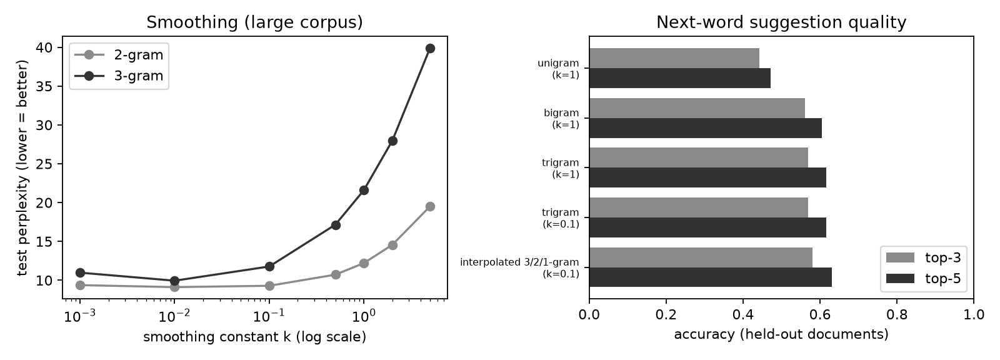

# Smart Keyboard V1

Next-word suggestions with an **n-gram language model** (unigram, bigram, trigram), **add-k smoothing** and **back-off**, served through a **Streamlit** interface.

**Live demo:** <https://smart-keyboard-achraf.streamlit.app/> 

---

## Features

- **Top-5 next-word suggestions**, clickable to build a sentence word by word
- **Back-off 3 → 2 → 1-gram** that only trusts contexts seen at least `min_count` times
- **Unknown-word handling**: "did you mean…?" corrections (`breakfst → breakfast`) and completion of partial words (`brea → bread, breakfast`)
- **Two corpora**: the original lab corpus and a larger synthetic corpus
- **Evaluation tab**: perplexity and top-3 / top-5 accuracy on held-out documents

## Project structure

```
├── app.py                  # Streamlit interface
├── requirements.txt
├── .streamlit/config.toml  # theme (Outfit font)
├── data/
│   ├── make_data.py        # generates the synthetic corpora
│   ├── corpus.csv          # small corpus  (1,200 sentences, 61 words)
│   └── corpus_large.csv    # large corpus  (6,000 sentences, 181 words)
├── src/
│   ├── pipeline.py         # n-gram model, smoothing, back-off, accuracy
│   └── evaluate.py         # evaluation script (tables, k sweep, chart)
└── results/
    ├── small/              # metrics.json, failures.txt, ngram_results.png
    └── large/
```

## Getting started

Requires Python 3.10+.

```bash
# 1. Create and activate a virtual environment
python -m venv .venv
.venv\Scripts\activate          # Windows
# source .venv/bin/activate     # macOS / Linux

# 2. Install the dependencies
pip install -r requirements.txt

# 3. (Optional) regenerate the corpora — they are already in the repo
python data/make_data.py --size both

# 4. Launch the app
python -m streamlit run app.py
```

The app opens at <http://localhost:8501>.

## Evaluation

```bash
python -m src.evaluate --corpus large --topk 5     # extended corpus
python -m src.evaluate --corpus small --topk 3     # reproduces the original lab numbers
```

Results on the **large corpus** (test set = last 20 % of documents):

| Model | k | Perplexity | Top-3 | Top-5 |
|---|---|---|---|---|
| Unigram | 1.0 | 48.32 | 44.2 % | 47.1 % |
| Bigram | 1.0 | 12.21 | 56.1 % | 60.5 % |
| Trigram | 0.1 | 11.77 | 56.8 % | 61.6 % |
| Trigram (unsmoothed) | 0 | ∞ | 56.8 % | 61.6 % |
| Interpolated 3/2/1 | 0.1 | 10.15 | 58.0 % | 63.1 % |
| **Back-off 3→2→1** (min_count = 10) | 0.1 | — | **58.4 %** | **63.9 %** |



## How it works

**Probability with add-k smoothing**

$$P(w_i \mid w_{i-2}, w_{i-1}) = \frac{\text{count}(w_{i-2}, w_{i-1}, w_i) + k}{\text{count}(w_{i-2}, w_{i-1}) + k \cdot V}$$

Smoothing gives unseen word sequences a small non-zero probability. Without it (k = 0), 9.5 % of test tokens get probability 0 and perplexity is infinite.

**Back-off with `min_count`**

The original back-off only fell back to a lower order when a context was *never* seen. A context seen only twice (e.g. `students eat → dinner`) was trusted anyway, and all other words tied at the same tiny smoothed probability. Two changes fix this:

1. Back off when a context was seen fewer than `min_count` times (default 10).
2. Break ties with the lower-order models instead of alphabetical order.

Back-off top-5 accuracy went from 62.4 % to 63.9 %.

**Split by document**

The test set is the last 20 % of *documents*, not random sentences. Documents share topic words, so a sentence-level split would leak them into training and inflate the scores.

## Limitations

- The corpus is **synthetic**: sentences come from a hand-written grammar, so the language is far more regular than real English and perplexities are low.
- Perplexities are only comparable with the **same vocabulary and test set**. The large corpus has a higher perplexity than the small one because the task is harder (3× more words), not because the model is worse.
- `k` and `min_count` were chosen on the test set, which is acceptable for a lab; a real study would use a separate validation split.
- An n-gram model only sees the last two words and has no notion of meaning.

## Tech stack

Python · Streamlit · pandas · matplotlib
